# 票管家 · 团队发票报销管理平台


面向小团队的发票收集与报销台账系统：成员一人一个账号，上传图片 / PDF 发票后由**本地离线识别**自动填单，确认后进入台账；管理员可以查看全员数据、维护报销状态，并一键导出「附件重命名 + 台账 Excel + 验收单 / 清单」的压缩包。

> 技术栈：**Go 1.23+ / MySQL 8.0 / Vue 3 / Arco Design Vue / ECharts**
> 识别引擎：**Windows 内置 OCR（Windows.Media.Ocr）或 Tesseract + 自研 PDF 文字层解析**，全程不联网、不上传第三方。

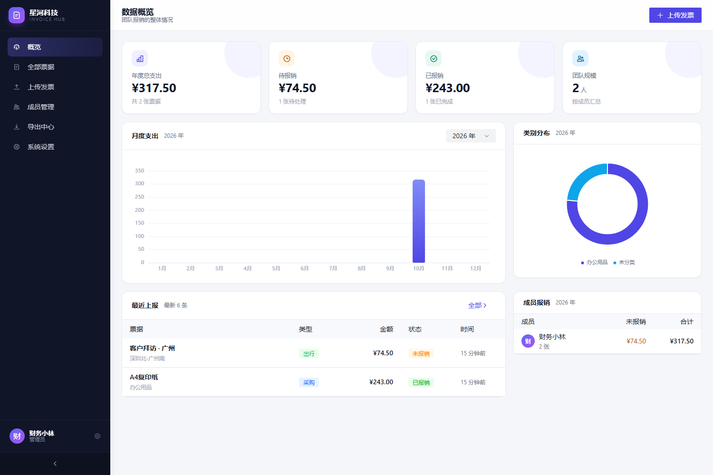

## 目录

- [1. 快速开始](#1-快速开始)
- [2. 目录结构](#2-目录结构)
- [3. 功能清单](#3-功能清单)
- [4. 导出包说明](#4-导出包说明)
- [5. 配置](#5-配置)
- [6. 常见问题](#6-常见问题)
- [7. 开发模式](#7-开发模式)
- [8. 界面预览](#8-界面预览)
- [9. 文档与版本](#9-文档与版本)

---

## 1. 快速开始

仓库只保留源码，不提交编译产物和构建结果，所以**第一次运行要先完成构建**。

前置条件：

| 组件 | 版本 | 用途 |
|---|---|---|
| MySQL | 8.0+ | 数据存储，默认监听 `127.0.0.1:3306` |
| Go | 1.23+ | 仅编译后端时需要 |
| Node.js + npm | 18+ | 仅构建前端时需要 |
| OCR 引擎 | 见[常见问题](#6-常见问题) | 图片 / 扫描件识别；PDF 文字层不需要 |

### Windows

1. **编译后端**：双击 `构建后端.bat`，或执行
   ```powershell
   cd server
   go build -o bin\invoice-server.exe ./cmd/server
   ```
2. **构建前端**：双击 `构建前端.bat`，产物输出到 `web\dist`。
3. **启动**：双击 `启动.bat`。脚本会检查 3306 端口、按需拉起 MySQL、启动服务并打开浏览器。

`启动.bat` 默认按本机 MySQL 安装目录查找 `mysqld.exe`；路径不同时，修改脚本里的 `INVOICE_MYSQL_HOME`，或提前手动启动 MySQL。

首次访问会进入「初始化」页，创建第一个管理员账号（团队名称、用户名、密码），之后即可在「成员管理」里给同事开账号。局域网内其他电脑用 `http://<本机IP>:8686` 访问。

停止服务：双击 `停止服务.bat`，或在服务窗口按 `Ctrl+C`。

### Ubuntu / Debian

```bash
# 1) 依赖：MySQL + 离线 OCR（Tesseract 中文包）
sudo apt update
sudo apt install -y mysql-server tesseract-ocr tesseract-ocr-chi-sim

# 2) 建库与账号：通过 INVOICE_DB_PASS 指定密码（请勿沿用脚本里的示例口令）
INVOICE_DB_PASS='<设置一个强密码>' bash deploy/init-db.sh

# 3) 编译后端 + 构建前端（需要 Go 1.23+ 与 Node 18+）
chmod +x start.sh deploy/*.sh
bash deploy/build-linux.sh

# 4) 启动
./start.sh

# 5) 开机自启（可选）
sudo cp deploy/invoice-hub.service /etc/systemd/system/
sudo systemctl daemon-reload && sudo systemctl enable --now invoice-hub
```

如果建库时用了自定义密码，启动时用 `INVOICE_DSN` 覆盖连接串：

```bash
INVOICE_DSN="invoice:<强密码>@tcp(127.0.0.1:3306)/invoice?charset=utf8mb4&parseTime=true&loc=Local" ./start.sh
```

### macOS

`start.sh` 默认查找 Linux 产物，macOS 需要自行编译 darwin 版本后运行：

```bash
brew install mysql tesseract tesseract-lang
brew services start mysql

# 建库：参考 deploy/init-db.sh 中的 SQL，用 mysql -u root 执行；
# 自定义密码时通过 INVOICE_DSN 传入。
cd server && go build -o bin/invoice-server ./cmd/server && cd ..
INVOICE_DSN="invoice:<密码>@tcp(127.0.0.1:3306)/invoice?charset=utf8mb4&parseTime=true&loc=Local" \
  ./server/bin/invoice-server -addr :8686 -web web/dist -data server/data
```

后台常驻可参考：

```bash
nohup ./server/bin/invoice-server -addr :8686 -web web/dist -data server/data \
  > server/data/logs/server.log 2>&1 & echo $! > server/data/server.pid
```

---

## 2. 目录结构

```
piaoguanjia/
├─ 启动.bat                # 一键启动（MySQL + 服务 + 打开浏览器）
├─ 停止服务.bat
├─ 构建前端.bat            # npm install + npm run build
├─ 构建后端.bat            # go build -> server/bin/invoice-server.exe
├─ start.sh                # Linux 启动脚本（macOS 见上文手动命令）
├─ deploy/                 # 建库脚本、Linux 构建、systemd 服务单元
├─ server/                 # Go 后端
│  ├─ cmd/server/main.go   # 入口：配置、启动、优雅退出
│  ├─ internal/
│  │  ├─ api/              # 路由、鉴权中间件、HTTP handler
│  │  ├─ auth/             # PBKDF2 口令 + 自签 JWT
│  │  ├─ config/           # 配置与数据目录
│  │  ├─ exporter/         # ZIP 打包、台账 Excel、验收单 / 清单模板
│  │  │  ├─ excel.go       # 明细 / 汇总 / 类别统计
│  │  │  ├─ form.go        # 验收单、采购清单、出行验收单
│  │  │  └─ templates/     # acceptance.xlsx、parts_list.xlsx（内嵌）
│  │  ├─ model/            # 数据模型
│  │  ├─ ocr/              # 离线识别：PDF 解析 / OCR / 版面与字段抽取
│  │  ├─ storage/          # 附件落盘、缩略图、保留期清理
│  │  └─ store/            # MySQL 连接、建表与增量迁移、设置、审计日志
│  ├─ migrations/          # 初始化库与账号 SQL
│  ├─ bin/                 # 编译产物（不提交）
│  └─ data/                # 运行时数据：附件、缩略图、临时文件、日志（不提交）
├─ web/                    # Vue 3 + Vite + Arco Design Vue
│  ├─ src/views/           # 登录、概览、上传向导、票据、成员、导出、设置
│  ├─ src/components/      # 票据详情抽屉等
│  └─ dist/                # 构建产物（不提交，由 Go 直接托管）
├─ docs/                   # 方案说明、接口文档、截图
├─ samples/                # 示例发票，可直接拖进上传页试用
└─ tools/                  # 运维小工具
```

---

## 3. 功能清单

**成员端**

- 上传图片（JPG/PNG/WEBP/BMP）或 PDF，自动识别：发票号码、开票日期、销售方、购买方、价税合计、税额、明细行（名称 / 规格 / 单位 / 数量 / 单价 / 金额 / 税率）
- 单位会跟随识别明细自动保存，导出验收单 / 清单时直接使用
- 三步向导：上传识别 → 补充信息（带「已识别」标记）→ 核对确认 → 提交
- 采购报销 / 出行报销两套表单，可随时切换
- 「我的发票」按全部 / 未报销 / 已报销筛选，支持按月份、类型、关键词检索
- 自己更新报销状态、查看附件、删除票据

**管理端**

- 数据概览：年度总额、待报销、已报销、团队规模，月度柱状图 + 类别环形图 + 成员排行
- 全部票据：按成员、状态、类型、月份、关键词筛选，行内可直接改报销状态
- 成员管理：新建 / 编辑 / 重置密码 / 停用 / 删除
- 导出中心：按月份 / 年份 / 自定义区间 / 全部导出，可叠加类型、状态、成员筛选
- 系统设置：团队名称、消费类别、上传限制、识别开关、保留策略、备份、审计日志

**识别与导出**

- PDF 文字层优先，电子发票逐字段解析；扫描件 / 图片走 OCR，引擎可在设置里切换
- 17 张真实发票回归：票号、日期、购销方、税号、金额、税额、明细逐项校验通过
- 导出台账带「明细 / 汇总 / 统计」三个工作表，支持筛选、冻结表头、自动合计
- 导出同时生成验收单与清单，按模板填充、保留原表格式与签字栏
- 导出文件按实际类型动态编号，不出现的类型不占号

---

## 4. 导出包说明

一次导出 = 一个 ZIP，文件名形如 `发票汇总_2026年11月_未报销_20261111_1602.zip`。

### 4.1 文件组成

| 编号 | 文件 | 生成条件 | 说明 |
|---|---|---|---|
| 01 | 采购报销明细.xlsx | 有采购票据 | 明细 / 汇总 / 类别统计 |
| 02 | 采购报销清单.xlsx | 有采购票据 | 按模板填充的采购清单 |
| 03 | 采购报销验收单.xlsx | 有采购票据 | 按模板填充，带签字栏 |
| 04 | 出行报销明细.xlsx | 有出行票据 | 明细 / 汇总 / 交通工具统计 |
| 05 | 出行报销验收单.xlsx | 有出行票据 | 出行专用验收单 |

编号按本次实际生成的文件顺序排列：

- **只导出采购**：`01 / 02 / 03`
- **只导出出行**：`01 / 02`（出行明细、出行验收单）
- **采购 + 出行**：`01 / 02 / 03 / 04 / 05`

### 4.2 压缩包示例

```
发票汇总_2026年11月_未报销_20261111_1602.zip
├─ 附件001_电子设备_17.90元.jpg      ← 原件按「附件序号_类别_金额元」重命名
├─ 附件002_电子设备_151.00元.pdf
├─ 01_采购报销明细.xlsx              ← 明细 / 汇总 / 类别统计
├─ 02_采购报销清单.xlsx              ← 采购清单（模板填充）
├─ 03_采购报销验收单.xlsx            ← 采购验收单（模板填充）
├─ 04_出行报销明细.xlsx              ← 有出行票据时才生成
├─ 05_出行报销验收单.xlsx            ← 有出行票据时才生成
└─ 导出说明.txt
```

- Excel 的「附件文件」列与压缩包里的文件名一一对应
- 一张票据多个附件时，文件名追加 `_2`、`_3` 后缀
- 采购与出行分开成表，列各自贴合业务；没有数据的类型不生成文件

### 4.3 Excel 样式

- 表头深色、白色加粗、单元格居中、细边框、冻结窗格、自动筛选
- 数量为整数，单价 / 金额 / 运费统一 `#,##0.00`，占比为真正的百分比格式
- 合计行加粗高亮，行高按内容自适应，长销售方 / 备注不会被截断
- 验收单 / 清单：宋体、全边框、居中；品名规格自动换行；A4 打印；采购模板 73% 缩放，出行验收单按页宽自适应
- 所有工作表默认隐藏网格线，打印时只显示表格边框

---

## 5. 配置

后端启动参数（也可用环境变量）：

| 参数 | 默认值 | 环境变量 | 说明 |
|---|---|---|---|
| `-addr` | `:8686` | `INVOICE_ADDR` | 监听地址，`:8686` 表示所有网卡 |
| `-dsn` | `invoice:<密码>@tcp(127.0.0.1:3306)/invoice?...` | `INVOICE_DSN` | MySQL 连接串 |
| `-data` | `data` | `INVOICE_DATA` | 附件与临时文件目录 |
| `-web` | `../web/dist` | `INVOICE_WEB` | 前端静态资源目录 |
| `-debug` | 关 | `INVOICE_DEBUG=1` | 打印所有请求日志 |

其他可选环境变量：

| 变量 | 说明 |
|---|---|
| `INVOICE_TESSERACT_PSM` | Tesseract 版面模式，默认 `6` |
| `INVOICE_DB_PASS` | `deploy/init-db.sh` 建库时使用的应用账号密码 |

数据库账号（见 `server/migrations/000_bootstrap.sql` 与 `deploy/init-db.sh`）：

- 应用账号 `invoice`，库 `invoice`；密码在建库时通过 `INVOICE_DB_PASS` 指定，脚本内置的示例口令请务必替换
- `root` 账号仅限本机运维使用，请单独设置强口令

> 生产环境请修改这两处密码，并同步修改 `-dsn`（或 `INVOICE_DSN`）与 `启动.bat` 里的 MySQL 路径。

---

## 6. 常见问题

**Q：启动后页面打不开 / 显示「前端尚未构建」？**

先执行一次 `构建前端.bat`（或 `cd web && npm run build`），确保 `web/dist/index.html` 存在；后端需要先编译出 `server/bin/invoice-server.exe`。

**Q：提示连不上 MySQL？**

看 `启动.bat` 是否成功拉起 MySQL；手动检查：

```bash
mysql -u invoice -p -h 127.0.0.1 invoice -e "select 1"
```

若数据目录损坏，可删除 MySQL 数据目录后重新初始化（会清空数据）。

**Q：识别没反应 / 提示 OCR 不可用？**

| 平台 | 引擎 | 安装方式 |
|---|---|---|
| Windows | Windows 内置 OCR | 系统自带；若无中文包：设置 → 时间和语言 → 语言 → 中文 → 选项 → 安装「光学字符识别」 |
| Ubuntu/Debian | Tesseract | `sudo apt install tesseract-ocr tesseract-ocr-chi-sim` |
| macOS | Tesseract | `brew install tesseract tesseract-lang` |

识别引擎在「系统设置 → 上传与识别」里可见并可切换（自动 / Windows 内置 / Tesseract / 关闭）。
**PDF 文字层不依赖任何 OCR 引擎**，电子发票即使没有 OCR 也能准确解析。

**Q：PDF 明明有文字，识别结果却是 0？**

v1.1.0 已修复「`/Contents` 指向数组对象」的 PDF 解析问题（部分模板生成的电子发票会命中）。升级到 v1.1.0 后重新上传即可；旧的上传结果不会自动更新。

**Q：为什么导出包里没有 02 / 04 / 05？**

编号按本次实际生成的类型动态排列：没有采购就不生成 01–03，没有出行就不生成 04–05；纯出行导出时出行文件会从 01 开始。具体见[导出包说明](#4-导出包说明)。

**Q：单位为什么是空的？**

单位取自上传时识别出的明细行。发票本身没有印单位（例如部分「万向轮」「技术服务费」）时留空，不影响金额与台账。老数据库启动时会自动补 `unit` 列。

**Q：端口 8686 被占用？**

```powershell
server\bin\invoice-server.exe -addr :8687 -web web\dist
```

**Q：怎么备份 / 迁移？**

「系统设置 → 下载完整备份」会打包 `data.json`（用户、票据、设置）与全部附件；迁移时在新机器恢复数据库与 `server/data/files` 即可。

**Q：数据保留多久？**

默认永久保存。可在「系统设置 → 存储与保留」改为按天自动清理，并选择「只删原件保留台账」或「连记录一起删」。

---

## 7. 开发模式

```powershell
# 后端（热重启随意）
cd server
go run ./cmd/server -addr :8686 -web ../web/dist

# 前端（Vite 开发服务器，已配置 /api 代理到 8686）
cd web
npm run dev        # http://127.0.0.1:5173
```

常用检查：

```bash
cd server
go test ./...
go vet ./...
```

验收单 / 清单模板位于 `server/internal/exporter/templates/`，通过 `go:embed` 打进二进制；调整版式时替换 xlsx 后重新编译即可。模板只保留表头、边框、合计与签字栏，不含示例数据。

---

## 8. 界面预览

| 首次初始化 | 登录 |
|---|---|
| 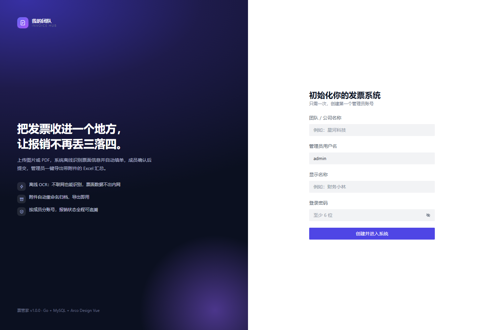 | 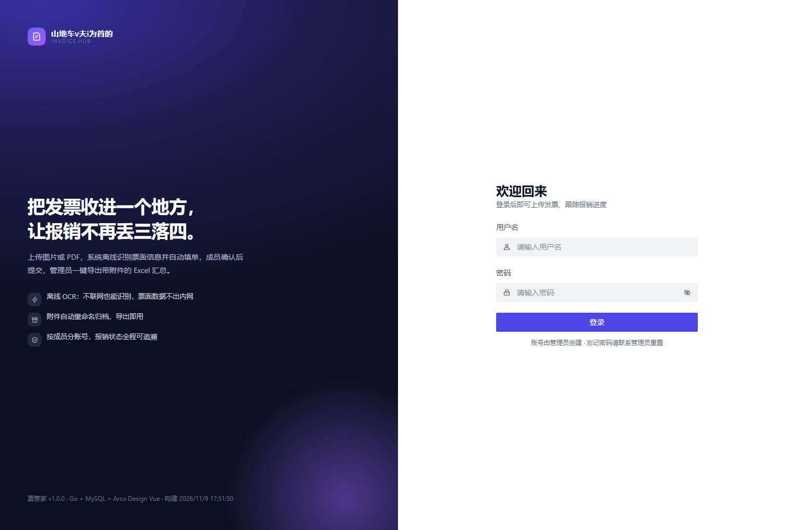 |
| **数据概览** | **上传识别** |
|  | 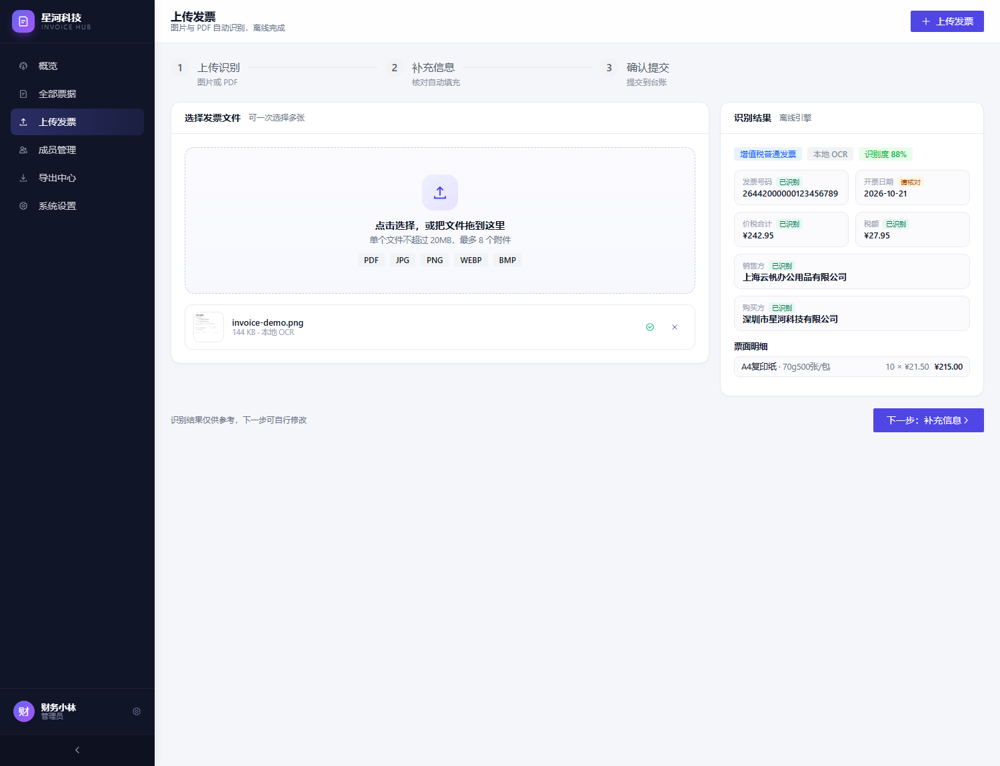 |
| **补充信息** | **确认提交** |
| 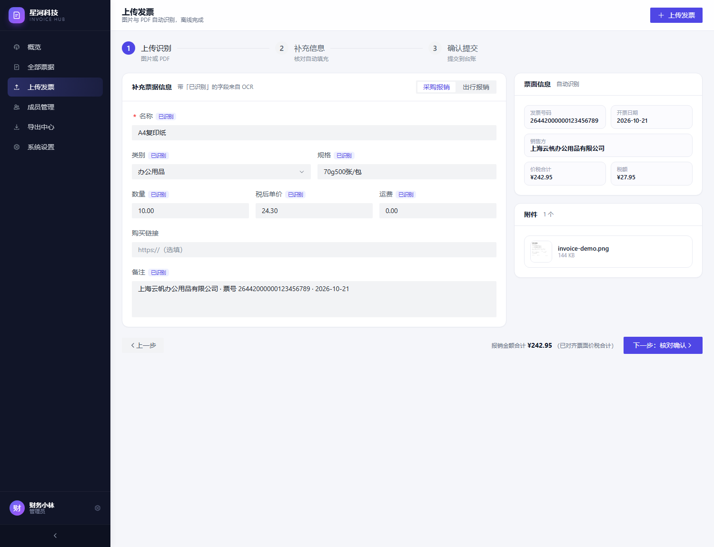 | 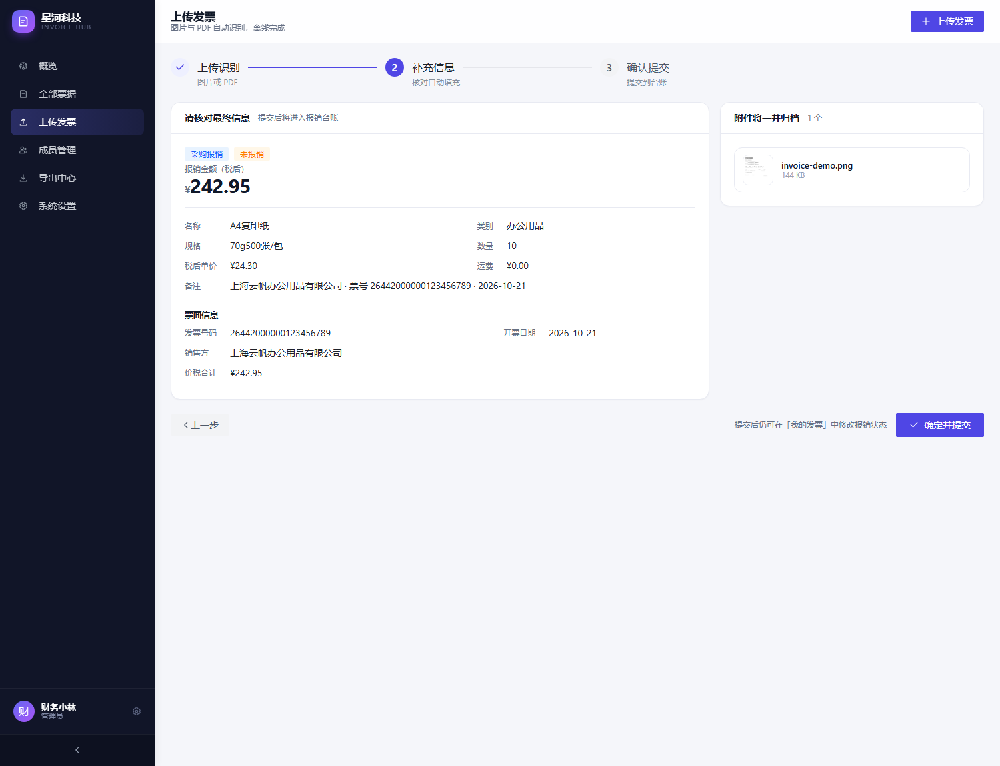 |
| **票据详情** | **票据列表** |
| 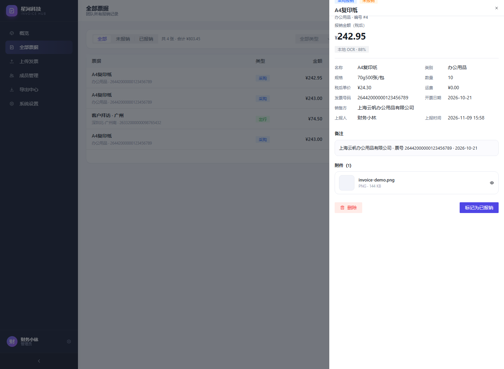 | 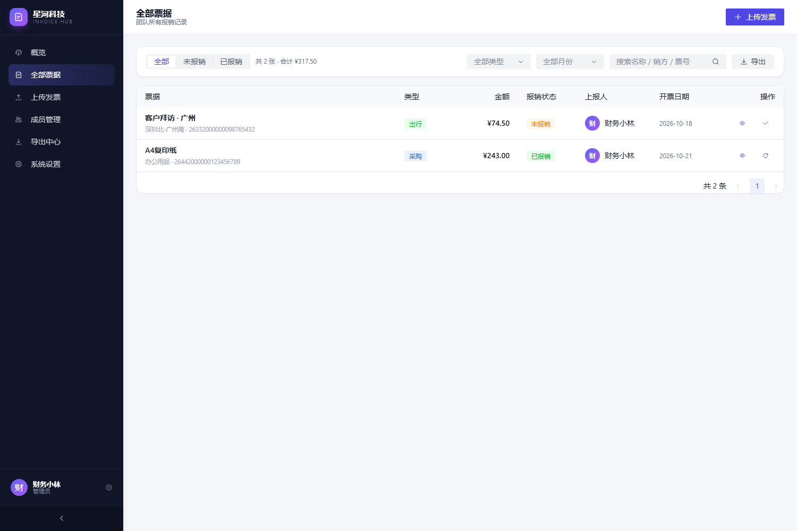 |
| **成员管理** | **导出中心** |
| 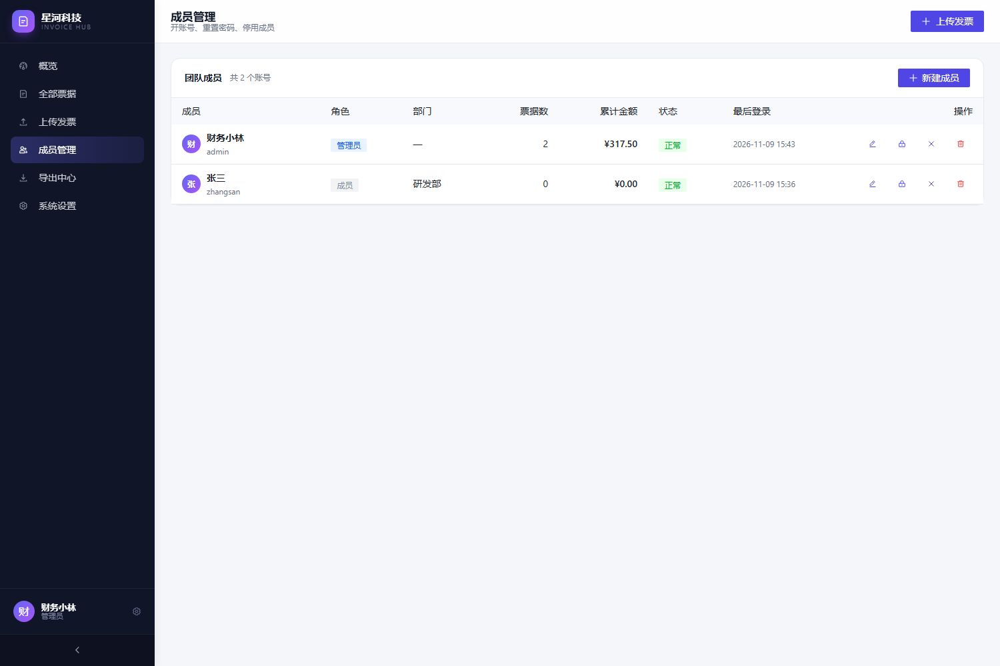 | 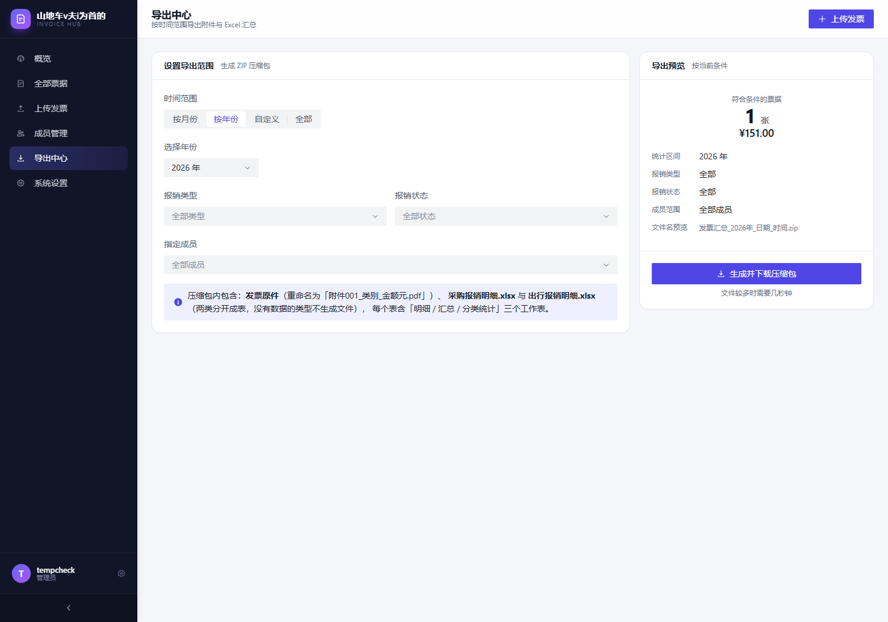 |
| **系统设置** | **成员工作台** |
| 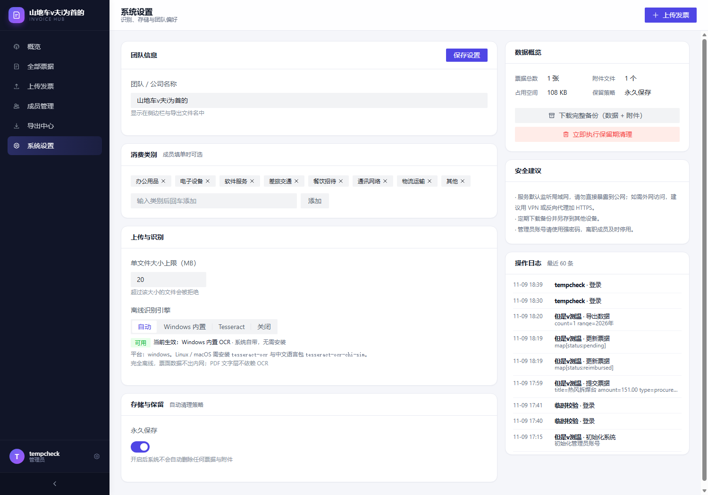 | 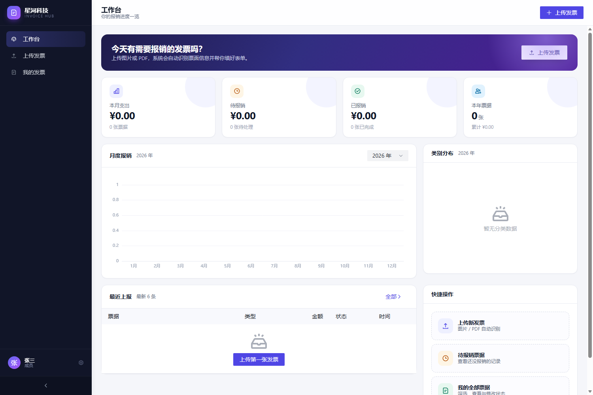 |

> 截图与 `samples/` 中的示例发票均为演示数据，不含真实票据信息。

---

## 9. 文档与版本

| 文档 | 内容 |
|---|---|
| [方案说明](docs/方案说明.md) | 设计目标、总体架构、数据模型、离线识别链路、权限与导出设计 |
| [接口文档](docs/接口文档.md) | HTTP API 一览、请求 / 响应示例、查询参数与错误码 |
| [文档索引](docs/README.md) | 文档与截图目录说明 |

**版本记录**

| 版本 | 日期 | 主要变化 |
|---|---|---|
| v1.1.0 | 2026-11-11 | 新增采购验收单 / 采购清单 / 出行验收单导出；票据单位字段；统一表格样式；修复 PDF 间接内容流解析 |
| v1.0.1 | 2026-11-10 | 修复发票明细识别：跨行名称规格、金额分列、红冲负数 |
| v1.0.0 | 2026-11-09 | 首个版本 |
